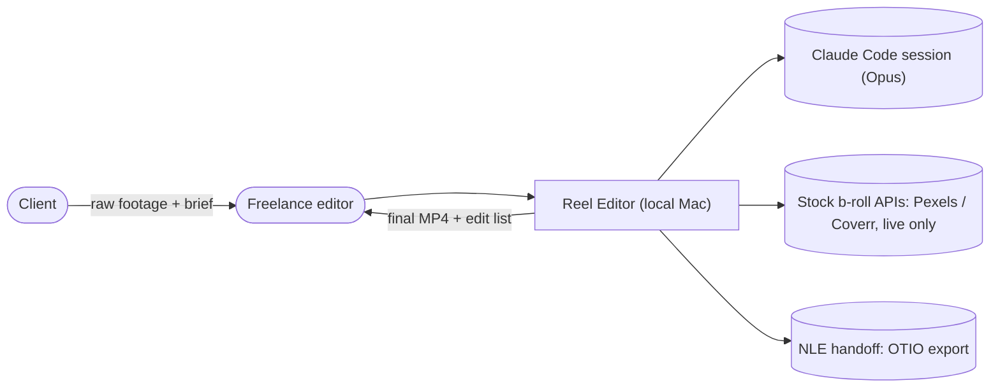
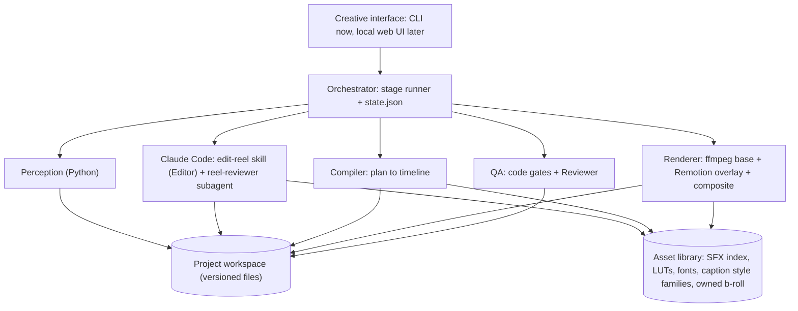
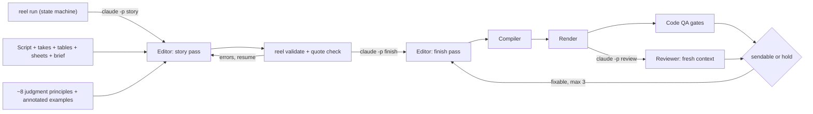
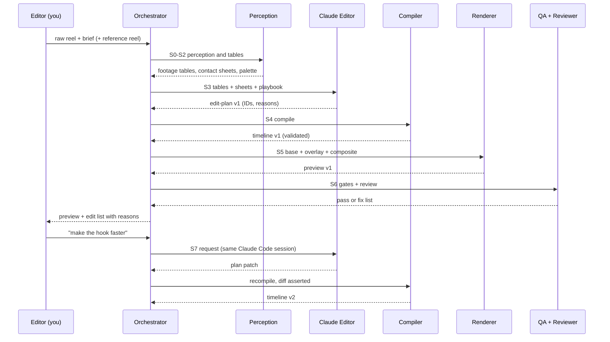

# Claude Reel Editor — Architecture

_Finalised 2026-11-18, including the council review ([review](reviews/2026-11-18-council-review.md)) · Status: Accepted (build path: ADR-0024) · Owner: project owner (freelance editor) · Requirements: [`requirements.md`](requirements.md)_

## 1. Goal and scope

A **personal, local tool that edits the reel autonomously** (ADR-0018) — raw reel (15–90 s, English / Hindi / Hinglish) + optional client brief, brand kit and reference reel in, **finished professional reel out**, with an NLE package (FCPXML, alpha overlay, stems, SRT) exported every run as an escape hatch. Accepts chat revisions ("make the hook faster"). Quality bar: an expert freelance editor (FR-11), **measured against the owner's own edits on a gold set** (ADR-0014).

Key numbers:
- Render of a 60 s 1080x1920 reel on the Mac (M5): **~54 s sequential** (sum of measured steps: base 11 s + overlay 36 s + composite 7 s); ~43 s if base and overlay run in parallel (**estimated, not run** — 16 GB RAM may contend).
- Claude usage: runs inside the owner's **Claude Code** plan (ADR-0019) — no per-token billing; reels per day bounded by plan usage limits (log sessions per reel). API-equivalent token volume ≈ 30k in + 15–25k out per first draft.
- Cuts on whole frames; A/V drift ≤ 20 ms; −14 LUFS / ≤ −1 dBTP.
- Everything free/open-source and local except Claude (via Claude Code) (C-9); all outputs usable in paid client work (C-8).

## 2. Principles

1. **Claude decides what and why; code decides how** (ADR-0001).
2. **Claude never touches video bytes or writes ffmpeg** — it reads text tables + contact sheets and writes a validated plan.
3. **Claude references IDs, never invents timestamps** — the compiler turns IDs into exact frames (ADR-0002).
4. **One canonical timeline** is the source of truth; every field has exactly one renderer owner (ADR-0003, ADR-0004).
5. **Code checks are the quality gate; Claude's judgment is advisory** (ADR-0006).
6. **Every decision carries a reason** the editor can read, accept or reject.
7. **Sources are immutable; every stage writes a versioned artifact** and the run can resume.
8. **Licence-clean by construction:** no AGPL/non-commercial components in the pipeline.
9. **One clock:** everything reads the S0 mezzanine; frame index on it is the single time base (ADR-0015).
10. **Taste is measured, not assumed:** every prompt/model change is scored on the gold set (ADR-0014); the editor is the final taste gate.

## 3. System context (C4 L1)



## 4. Containers (C4 L2) — modular monolith, Python + one TypeScript renderer



## 5. Pipeline stages

| Stage | Does | Output artifact | Tools |
|---|---|---|---|
| S0 Ingest + mezzanine | Copy source, probe, fingerprint; write one **mezzanine per clip** (CFR at project fps = source fps, bt709 SDR tonemapped, rotation baked, 48 kHz, short GOP) | `source/`, `mezz/`, `probe.json` | ffprobe, ffmpeg |
| S1 Perception | On the mezzanine: ASR words, VAD/fillers, scenes, faces, energy curves, palette; prosody per segment (rate, pitch, loudness) | `perception/*.json` | mlx-whisper (+ Hinglish engine per ADR-0007), Silero VAD, IndicXlit, PySceneDetect, MediaPipe, pyloudnorm, k-means palette |
| S2 Footage tables | Segments + people tables + contact sheets (timestamped) | `tables/footage.json`, `tables/sheets/*.png` | Python, ffmpeg |
| S2.5 Selects | Group retakes, flag restarts/stumbles, take table with delivery stats; script with inline `[seg]` tags | `tables/selects.json`, `tables/script.md` | Python |
| S3a Plan — story | Takes, 2–3 ranked hook options, kept ranges + order; `dry_run_compile` read-back before commit | `plan/story.vN.json` | Claude Code, Opus (edit-reel skill) |
| S3b Plan — finish | Emphasis, punch-ins, b-roll, SFX, captions (brand tokens) on the locked story | `plan/edit-plan.vN.json` | Claude Code, Opus (edit-reel skill) |
| S4 Compile | Validate + quote check, IDs → mezzanine frames via shared time-map, snap cuts to speech, frame-align, expand ducking/SFX/caption rules | `timeline/timeline.vN.json` | pydantic, compiler |
| S5 Render | ffmpeg base (per-segment cuts, `fps=` after retime, voice chain, room tone) ∥ Remotion overlay (ProRes 4444 alpha) → composite, copy base audio | `render/preview.vN.mp4` | ffmpeg, Remotion 4.0.538 headless |
| S6 QA | Calibrated code gates measured on the render; Reviewer (narrowed) checks the plan's stated intents | `qa/report.vN.json` | ffmpeg detectors, MediaPipe, reel-reviewer subagent (Opus) |
| S7 Revise | Chat request or client note → patch ops by item ID → S4–S6 | new `vN+1` artifacts | Claude Code session |
| S8 Package | Preview MP4 + **NLE package**: FCPXML/OTIO, ProRes 4444 alpha overlay, stems, SRT/VTT, edit list with reasons; delivery profile variants | `render/`, `export/` | ffmpeg, FCPXML writer, OTIO |

## 6. What Claude sees and writes

`reel run` orchestrates every stage (ADR-0020). Claude Code is called headless only at decision points — story pass, finish pass, review, fix decisions, chat revisions — each with `--json-schema`, a persona file and `--allowedTools Read`.

**Reads (files written by `reel`, opened with the Read tool):**
- Tagged script with `[seg]` markers + take table (retakes, delivery stats) from the selects stage.
- Segment table: `seg_id, t0, t1, words[i..j], speaker, shot_type, face_box, motion, brightness, audio_energy, silence, filler`; people/objects table.
- Word table (index, text, confidence) — low-confidence words flagged.
- Contact sheets (12 frames / sheet), `palette.json`, beat grid, SFX index, music index, caption style families, structured brief, brand kit, reference style vector.
- `dry_run` read-back (durations, cut rate) of a draft story before committing.

**Writes:** plan JSON returned by `claude -p --json-schema` — story pass (takes, ranked hooks, kept ranges by `seg_id` + word indices with quoted first/last word, order) and finish pass (punch-ins/camera moves, speed ramps, transitions, b-roll, caption family + tokens + emphasis words, SFX ids, music id) — each item with a stable ID and a `reason`. `reel validate` checks schema, quote match and ranges; errors go back in the same session (`--resume`).

## 7. Timeline and renderer ownership (ADR-0003, ADR-0004)

- Own pydantic v2 schema → JSON Schema (for Claude) + TypeScript types (for Remotion).
- Placement in integer frames at one fps; source points in integer microseconds; clip-relative keyframes `[{f, v, ease}]`; asset pool by ID; `src:{segment, words}` provenance on every clip.

| ffmpeg (base layer: pixels + sound) | Remotion (transparent overlay) |
|---|---|
| Cuts, order, reframe/crop, punch-ins, camera moves, **speed ramps**, LUT/grade, shot transitions, full-screen b-roll, voice, music bed, ducking, SFX, loudness, subject-matte composite | Kinetic captions/typography, hook titles, lower thirds, CTA, stickers/emoji/icons, picture-in-picture, flashes/light leaks |

Details and benchmark: [`architecture/renderer-split.md`](architecture/renderer-split.md).

## 8. Component view — Claude loop (riskiest container)



## 9. Key flow — first draft and one revision



## 10. QA (ADR-0006)

- **Gates (code, measured on the render — ADR-0017):** dead air > 1.5 s, frozen > 3 s, black frames, face cut by frame edge, caption over face (overlay alpha vs faces on rendered base), contrast ≥ 4.5:1 on final pixels, ≤ 20 chars/s, loudness −14 LUFS / ≤ −1.5 dBTP on the encoded file, A/V sync via beep+flash probe, frame count = plan, caption text from timeline props, low-confidence words resolved, CTA/logo inside safe zone. Each gate starts as a warning until its false-positive rate is measured on clean gold-set renders.
- **Configurable warnings (code):** text outside the platform safe zone (default x 120–888, y 288–1248 — secondhand ad-template numbers; pro reels place text outside it on purpose).
- **Additional gates (ADR-0021/0023):** caption words verified against brief/brand/OCR vocabulary; brief compliance (must-keep lines, CTA, product names, banned claims); skin-tone range; highlight clipping; brand swatch ΔE; per-render sync/identity (audio cross-correlation ≤ 20 ms, perceptual hash vs mapped mezzanine frame).
- **Reviewer (fresh-context Claude Code call):** checks the plan's own stated intents on contact sheets and judges story from a read-back transcript. Calibrated against the owner's labels on the tool's own rough renders before the auto-fix loop is trusted (Experiment 1 used synthetic defects only).
- **Instruction check:** timeline-diff assertions per request type (e.g. "faster hook" shortens segment 1 and leaves the rest unchanged).
- **Verdict (ADR-0021):** after at most 3 automatic fix loops the run ends `sendable` or `hold(reasons)`; uncertain caption words always give `hold` with a timecoded proof list (~30 s owner check, then overlay re-render).

## 11. Project workspace

```
projects/<name>/
  state.json                 stage status, versions, resume point
  source/                    immutable originals
  perception/                probe, words, vad, scenes, faces, ocr, energy, beats, palette
  tables/                    footage.json, sheets/*.png
  plan/edit-plan.vN.json
  timeline/timeline.vN.json
  render/                    base.vN.mp4, overlay.vN.mov, preview.vN.mp4, final.mp4
  qa/report.vN.json
  export/                    final .otio, edit-list.md
  log/runs.jsonl             stage timings, validation errors, Claude Code version + model ID + session id per decision call
  verdict.json               sendable | hold + reasons + proof list
assets/                      sfx/ + sfx_index.json, music/ + music_index.json, luts/, fonts/, caption_styles/, broll_owned/
brands/<client>.json         brand kit; briefs/<project>.json structured brief
```

## 12. Technology stack

| Concern | Choice | Licence |
|---|---|---|
| Language / runtime | Python 3.12 (uv), TypeScript only for Remotion | – |
| Schemas | pydantic v2 → JSON Schema + generated TS types | MIT |
| Orchestration | `reel run` state machine (Python) — ADR-0020 | – |
| Claude | **Claude Code** (owner's plan, pinned version): headless `claude -p --json-schema` calls at decision points; `edit-reel` skill (`/edit-reel`) + `reel-reviewer` subagent for interactive use; SessionStart hook via `$CLAUDE_PROJECT_DIR` | – |
| Craft knowledge | [`docs/research/craft-playbook.md`](research/craft-playbook.md): mechanical rules → compiler/gates; ~8 judgment principles + 2–3 annotated gold edits → Editor persona (ADR-0016) | – |
| ffmpeg | **Pinned build** with libzimg, libplacebo, libass, VideoToolbox (ADR-0023) | LGPL/GPL |
| Music | Owned/licensed library + index (BPM, sections, clean endings, beat grid) — ADR-0022 | per track |
| Bench / Remotion starter | `tools/bench/` (ffmpeg base graph, LUT script, Remotion project with headless shell) | – |
| ASR | mlx-whisper large-v3-turbo (EN); Hinglish engine by bake-off (Whisper large-v3 / Shruti / Oriserve / IndicWhisper) | MIT / Apache-2.0 |
| Speech helpers | Silero VAD, IndicXlit | MIT |
| Vision | MediaPipe (faces, pose, person segmentation); SAM 2.1 only if mattes need it | Apache-2.0 |
| Scenes / OCR | PySceneDetect, TransNetV2, PaddleOCR | BSD / MIT / Apache-2.0 |
| Audio analysis | beat_this, librosa, pyloudnorm | MIT / ISC / MIT |
| Render | pinned ffmpeg (above), Remotion 4.0.538 (headless shell) | LGPL/GPL build; Remotion free tier |
| Interchange | OpenTimelineIO export | Apache-2.0 |
| **Not used** | Google ADK, Temporal/Kafka, vector DB, Adobe adapters, YOLO (AGPL), WhisperX Hindi aligner, VoiceStudio (AGPL) | – |

## 13. Decision index

| ADR | Title | Status |
|---|---|---|
| [0001](adr/0001-claude-plans-tools-perceive-and-render.md) | Claude plans; tools perceive and render | Accepted |
| [0002](adr/0002-intent-plan-compiled-to-timeline.md) | Intent plan compiled to exact timeline | Accepted |
| [0003](adr/0003-own-timeline-schema-otio-export.md) | Own timeline schema; OTIO export only | Accepted |
| [0004](adr/0004-ffmpeg-base-remotion-overlay.md) | ffmpeg base + Remotion overlay; speed ramps in ffmpeg | Accepted |
| [0005](adr/0005-single-orchestrator-two-personas.md) | One orchestrator, Editor + Reviewer personas | Accepted |
| [0006](adr/0006-deterministic-qa-gates.md) | Code QA gates; Claude judge advisory | Accepted |
| [0007](adr/0007-asr-selected-by-bakeoff.md) | Free local ASR stack; Hinglish engine by bake-off | Accepted (engine slot pending) |
| [0008](adr/0008-curated-sfx-library.md) | Curated SFX library + JSON index | Accepted |
| [0009](adr/0009-local-first-execution.md) | Local-first execution | Accepted |
| [0010](adr/0010-claude-api-integration.md) | Claude API integration (models, caching, structured plan; no ADK) | Superseded by 0019 |
| [0019](adr/0019-claude-code-runtime.md) | Claude Code is the runtime (skill + subagent + CLI engine) | Accepted |
| [0011](adr/0011-adaptive-caption-style-engine.md) | Adaptive caption & typography style engine | Accepted · amended by 0017 |
| [0012](adr/0012-assistant-first-nle-finish.md) | Assistant-first; NLE finishing package | Superseded by 0018 |
| [0018](adr/0018-autonomous-professional-edit.md) | Autonomous professional edit by default; NLE package as escape hatch | Accepted |
| [0013](adr/0013-spike-social-video-agent.md) | Trial social-video-agent before building (fork vs build) | Superseded by 0024 |
| [0024](adr/0024-build-core-reuse-sva-modules.md) | Build our own core; reuse social-video-agent's proven modules | Accepted |
| [0025](adr/0025-remotion-only-motion-graphics.md) | Remotion only for motion graphics | Superseded by 0026 |
| [0026](adr/0026-claude-motion-optional-fallback.md) | Remotion default; Claude Motion opt-in fallback for full-frame cards (manual export → hold) | Accepted |
| [0027](adr/0027-expert-knowledge-system-and-learning-loop.md) | Expert knowledge system (capability catalog, craft graph, reference reels) + learning loop | Accepted |
| [0028](adr/0028-external-expert-and-audience-evaluation.md) | Quality judged by a hired pro editor + audience data | Accepted |
| [0029](adr/0029-eval-harness-and-self-improvement-loop.md) | Eval harness + gated self-improvement loop (knowledge/prompts only; holdout never used) | Accepted |
| [0030](adr/0030-harness-rules-score-and-acceptance.md) | Decision-call rules, primary score, change-acceptance rule; no `--bare` (plan login) | Accepted |
| [0031](adr/0031-web-sourced-gold-set-and-hybrid-holdout.md) | Gold set from the web (official Shorts vs episode source, verified); 6 English pairs all tune; holdout filled later (web English + editor-made Hinglish); release locked until 6 incl. ≥ 2 Hinglish | Accepted |
| [0032](adr/0032-hinglish-asr-answer-key.md) | Hinglish ASR answer key: MUCS 2021 now (in-domain discount), creator human subtitles later (overrides) | Accepted |
| [0033](adr/0033-calibration-known-good-known-bad-plus-pro-labels.md) | Calibration: pro finals = known-good, injected defects = known-bad (now); pro-editor labels for κ at release; owner labels optional | Accepted |
| [0034](adr/0034-release-judgement-two-independent-editors.md) | Release judged by an independent pro editor, separate from the gold-set editor; blind, standalone, ≥ 5/6 and no false sendable | Accepted |
| [0014](adr/0014-gold-set-evaluation.md) | Gold-set evaluation is the quality instrument | Accepted |
| [0015](adr/0015-ingest-mezzanine-canonical-clock.md) | S0 mezzanine, one canonical clock | Accepted |
| [0016](adr/0016-selects-stage-two-pass-plan.md) | Selects stage, two-pass plan, patch ops, quote check, playbook split | Accepted |
| [0017](adr/0017-council-revisions-qa-captions-audio-delivery.md) | Gate calibration, brand-first captions, audio finishing, delivery profile | Accepted |
| [0020](adr/0020-cli-orchestrator-claude-at-decision-points.md) | `reel run` orchestrates; Claude Code called headless at decision points | Accepted |
| [0021](adr/0021-release-acceptance-and-sendable-verdict.md) | Release acceptance (6 held-out, ≥ 5/6), sendable/hold verdict, caption proof | Accepted |
| [0022](adr/0022-owned-music-library.md) | Owned music library with musical editing | Accepted |
| [0023](adr/0023-ffmpeg-build-and-colour-pipeline.md) | Pinned ffmpeg build (HDR tonemap, libass) + colour pipeline | Accepted |

## 14. Risks (review, 2026-11-18)

| Risk | Likelihood | Impact | Mitigation | Status |
|---|---|---|---|---|
| Edits are "correct but generic" (not pro-level) | High | High | Gold-set blind A/B (ADR-0014), selects + two-pass plan (ADR-0016), principles + annotated examples instead of quotas, Reviewer + auto-fix loop and NLE escape hatch (ADR-0018) | Open — now measurable; this risk is higher under autonomous mode |
| Real phone footage breaks timing (HDR, rotation, VFR, mixed fps) | High | High | S0 mezzanine + conformance corpus (ADR-0015) | Designed — covered by the acceptance test |
| Rebuilding what social-video-agent already does | Medium | Medium | Reuse its proven modules (ADR-0024); SVA baseline sets the floor to beat | Designed |
| No reliable free Hinglish word timing | Medium | High | Pass/fail bake-off vs hand-labelled onsets, CTC aligner candidate, phrase-level fallback (ADR-0007) | Open |
| Hinglish ASR accuracy / caption sync | High | High | Bake-off on real clips; vocabulary prompt; VAD snapping; low-confidence review | Open — needs clips |
| Claude misjudges visual problems | Medium | High | Exp 1: Opus 6/6, 0 false alarms — but synthetic, obvious defects on pro footage, and the freeze catch used a clean twin that production won't have; code gates carry QA | Partially mitigated — retest on the tool's own rough renders |
| Frame drift across cuts (1802 vs 1800 seen) | High | Medium | Compiler frame-aligns; QA asserts frame count | Designed |
| Caption style families look amateur | Medium | High | Design families from pro references; contrast/safe-zone gates | Open — design work |
| Licence contamination | Medium | High | Licence column in stack; blocklist in §12 | Designed |
| Music copyright claims on client deliverables | High if songs used | High | No songs in export; music decision per project | Designed |
| Stock ToS breach (caching API assets) | Medium | High | Live-only use; library holds owned/CC0/generated only | Designed |
| Claude Code usage limits / autonomous run stalls (permission prompts, context limits, background-timeout exits) | Medium | Medium | `reel run` owns sequencing; short headless decision calls with explicit `--allowedTools`; artifact gates; headless smoke test with 0 prompts (ADR-0020) | Designed |
| Tool returns a bad reel without flagging it | Medium | High | `sendable`/`hold` verdict; false `sendable` fails the release; caption proof list (ADR-0021) | Designed |
| Local ffmpeg can't tonemap HDR / lacks libass | High (observed) | High | Pinned ffmpeg build (ADR-0023) | Designed |
| Full scope in one release stalls (council: 22–28 weeks solo) | High | Medium | Dependency-ordered checkpoints with tuning-set scores; reuse of SVA modules (ADR-0024) shortens the build vs pure from-scratch (not re-estimated) | Accepted by owner |
| Corporate TLS breaks downloads | High (observed) | Low | `NODE_EXTRA_CA_CERTS` / `SSL_CERT_FILE` bundle | Mitigated |
| 16 GB RAM limits parallel renders | Medium | Low | Render base and overlay in parallel only; one project at a time | Accepted |

## 15. Build plan — one complete release

Built in one go (owner decision, 2026-11-18): one release, **full scope kept** (owner decision after council re-review; council estimate 22–28 weeks solo if built from scratch, less if forked). Steps are in dependency order; internal checkpoints (CP) log the tuning-set score but are not releases.

**Before building (step 0)**
- Gold set in `samples/gold/<name>/{raw/, final.mp4, brief.md}`: ≥ 12 pairs → tuning set + **6 held out (≥ 2 Hinglish)**.
- Hinglish clips + hand-labelled word onsets; golden phone-footage corpus (rotated iPhone HDR, VFR low-light, 60 fps, mixed-fps, clap/flash).
- Owned music library started (ADR-0022); Remotion licence confirmation; pinned Claude Code version.
- Headless smoke test: stub `reel run` + every `claude -p` call, 0 permission prompts (ADR-0020).
- **SVA baseline** (ADR-0024): run social-video-agent on 2 tuning gold reels and score them with the gold harness — the floor our build must beat. Copy the reusable SVA modules into `engine/vendor_sva/` with its LICENSE/NOTICE.

**Build order**
1. Pinned ffmpeg build; S0 mezzanine + shared time-map; `reel run` state machine; workspace/state; **eval harness** `reel eval` (gold-plan alignment, metrics, scoreboard, holdout runner — ADR-0029); conformance tests.
2. Schemas (plan, timeline, captions) → compiler + `reel validate` (quote check, ranges) + `dry_run`; stub caption family, SFX and music indexes.
3. Perception: English ASR, VAD/fillers, scenes, faces, energy, prosody, palette, OCR; structured brief + brand kit loaders.
4. Footage tables + selects (retakes, delivery stats, tagged script) + contact sheets. Then enable **loop v0** (plan-level, text-only self-improvement — ADR-0029).
5. Editor decision calls (story pass, finish pass, patch ops, chat revisions via `--resume`) → ffmpeg base cuts → MP4. **CP1: walking skeleton.** Then enable **loop v1** (full self-improvement on rendered reels — ADR-0029).
6. Remotion overlay (caption families + brand tokens, hook titles, stickers, b-roll PiP, flashes) + composite (RGB straight alpha). **CP2.**
7. Audio finishing (voice chain incl. de-reverb/clicks/level match, room tone, ducking), SFX library, music library + musical edit; punch-ins/camera moves, speed ramps (non-speech), transitions; colour (per-clip correction → partial LUT). **CP3.**
8. Hinglish engine (bake-off winner), IndicXlit, caption word-accuracy + proof list, phrase-level fallback. **CP4.**
9. QA gates (warn → calibrate → hard), Reviewer calibrated on rough renders, bounded fix loop, `sendable`/`hold` verdict. **CP5.**
10. Full-scope extras: client b-roll pool + stock APIs (live), reference-style imitation, palette-adaptive captions, client-note importer + review copies, text-behind-subject matte (SAM 2.1 / MediaPipe), delivery variants, NLE package (OTIO + FCPXML + alpha MOV + stems + SRT). **CP6.**
11. Tune on the tuning set → **release candidate → holdout acceptance run.**

**Release acceptance test (ADR-0021, amended by ADR-0031/0034: independent hired judge; holdout = 6 incl. ≥ 2 Hinglish, filled by web pairs + editor-made Hinglish gold)**
- Owner judges each of the 6 held-out reels on its own: "sendable with no edits" — **pass = ≥ 5 of 6**.
- Every reel the tool marked `sendable` is judged sendable (no false `sendable`).
- Conformance corpus passes; captions in sync and word-accurate (English + Hinglish); headless run with 0 permission prompts.

## 16. Open items

- **Blocking (step 0):** gold set with 6 held out; SVA baseline run (ADR-0024); Hinglish clips + labelled onsets; phone-footage corpus; music library; Remotion licence confirmation.
- Hinglish engine choice — bake-off in step 8 (pass/fail word timing).
- Caption script default for Hinglish (Roman / Devanagari) — per-project setting.
- Claude Code: project config (`.claude/skills/edit-reel`, `.claude/agents/reel-reviewer`, SessionStart hook via `$CLAUDE_PROJECT_DIR`); `lean-ctx allow` for reel, ffmpeg, ffprobe, npx, claude.
- **Remotion licence eligibility: you must confirm yourself** after reading https://www.remotion.dev/license (free for individuals / companies ≤ 3 people).
- Research references: [`research/craft-playbook.md`](research/craft-playbook.md), [`research/competitor-teardown.md`](research/competitor-teardown.md), [`research/asset-licensing.md`](research/asset-licensing.md).
- Verify: stable-ts licence, Kenney SFX licence, Stable Audio Open licence terms, RIFE weights licence (deferred).

## 17. Relationship to "Spec v1.0" (user-supplied)

Spec v1.0 remains the long-term target. This architecture adopts its core loop (canonical timeline, renderer capability ownership, QA on rendered output, reasons recorded, human approval) and defers its platform pieces (Temporal, Kafka, vector DB, Adobe adapters, 7 Claude roles) until a requirement forces them.
